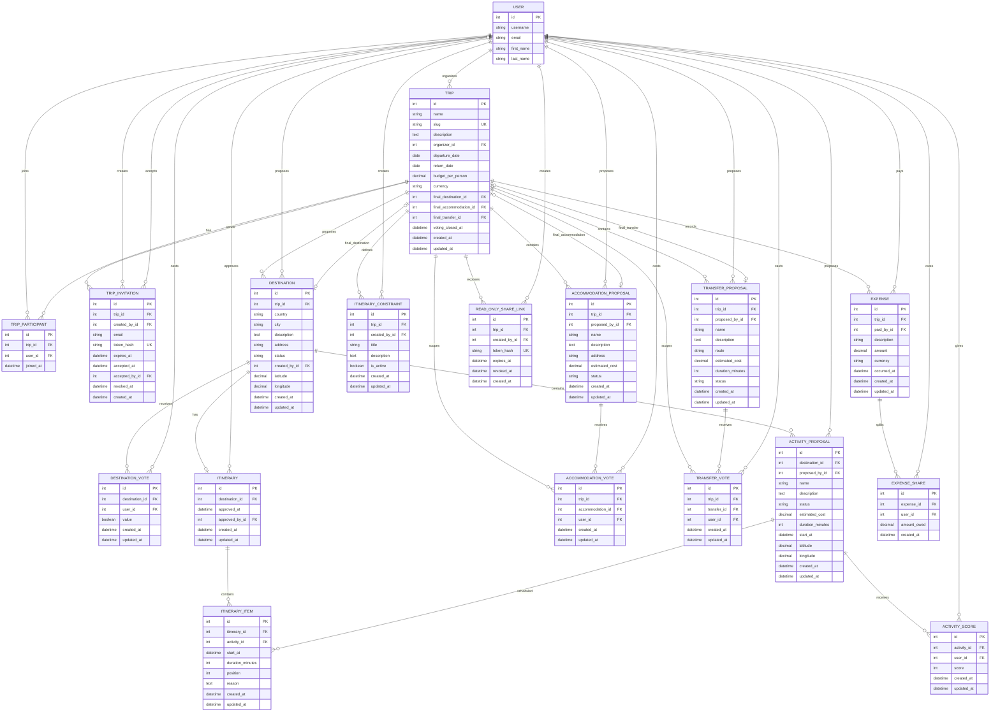

# Schema bazei de date

Schema reflectă modelele Django din aplicația `trips`. `USER` este tabela
Django `auth_user`; câmpurile care se termină în `_id` sunt chei străine.

`Trip.total_budget` nu este o coloană persistentă; este calculat ca
`budget_per_person * numărul participanților`.

Constrângerile de unicitate importante sunt: un participant per pereche
`trip/user`, un vot per pereche propunere/utilizator, un scor per pereche
activitate/utilizator, un share per pereche cheltuială/utilizator și un singur
itinerar per destinație.
