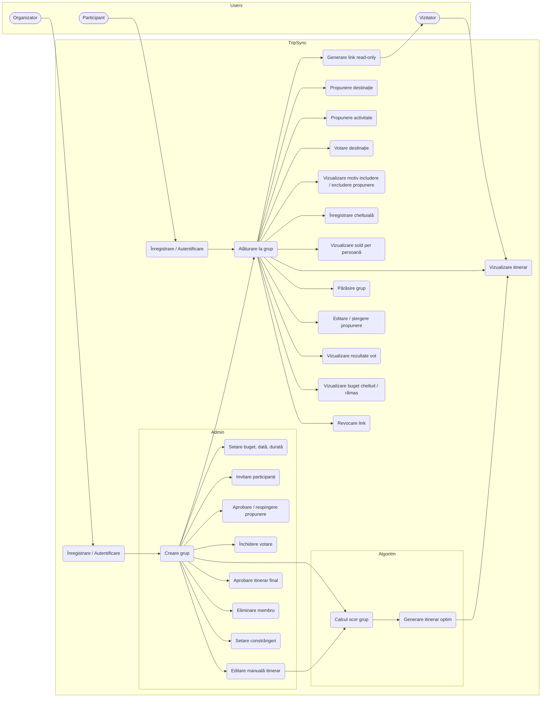

# TripSync – Requirements Document

|                   |                                                   |
| ----------------- | ------------------------------------------------- |
| **Produs**        | TripSync – Planificator colaborativ de excursii   |
| **Product Owner** | Ghidic Vladislav                                  |
| **Scrum Master**  | Oprea Marina                                      |
| **Echipa**        | Oprea Maria, Ghidic Vladislav, Suciu Delia Bianca |
| **Versiune**      | 0.2 (draft)                                       |
| **Data**          | 19/10/2026                                        |

## Istoric versiuni

| Versiune | Data       | Autor            | Modificări                               |
| -------- | ---------- | ---------------- | ---------------------------------------- |
| 0.1      | 16/10/2026 | Ghidic Vladislav | Versiune inițială                        |
| 0.2      | 19/10/2026 | Ghidic Vladislav | Reformulare si aduagare usecasuri uitate |
| 0.3      | 19/10/2026 | Ghidic Vladislav | Adaugat Scrum Master                     |

---

## 1. Scopul documentului

Documentul descrie problema abordată de TripSync, utilizatorii, cerințele funcționale și nefuncționale, obiectivul produsului și funcționalitățile sub forma unui Use Case Diagram. Este documentul de bază din care se derivă User Stories și Product Backlog-ul.

## 2. Descrierea problemei

Organizarea unei excursii în grup este un proces haotic și timp-consuming. Dacă nu există o persoană care doreste sa organizeze grupul, deciziile se amână, iar discuțiile se pierd între mesaje.

**Cine are problema.** Grupuri de prieteni (3–10 persoane) care vor să plece împreună într-o excursie.

**Cum se rezolvă astăzi.** Prin chat-uri de grup, polls si fisiere EXEL.

**Ce nu funcționează:**

- ideile și propunerile se pierd în conversații lungi;
- preferințele membrilor nu sunt luate în calcul în mod egal, iar decizia o impune cel mai activ din grup;
- bugetul se depășește pentru că nimeni nu sta sa caluleze totalul activităților alese;
- nu este clar cine a plătit ce și cine cui datorează bani.

**Ce aduce TripSync.** O aplicație în care grupul propune destinații și activități, votează, iar sistemul selectează automat setul de activități care maximizează preferințele grupului fără a depăși bugetul.

## 3. Product Goal

Un grup de prieteni poate decide rapid și echitabil ce activități include într-o excursie, ținând cont de preferințele tuturor și fără a depăși bugetul comun.

## 4. Utilizatori

| Rol             | Descriere                                                                            | Drepturi principale                                                                                                                                                                        |
| --------------- | ------------------------------------------------------------------------------------ | ------------------------------------------------------------------------------------------------------------------------------------------------------------------------------------------ |
| **Organizator** | Utilizatorul care creează grupul. Este responsabil de cadrul excursiei.              | Creează grupul, setează bugetul, data și durata, invită participanți, aprobă/respinge propuneri, închide votarea, generează și aprobă itinerarul. Are și toate drepturile Participantului. |
| **Participant** | Membru al unui grup, înregistrat și autentificat.                                    | Propune destinații și activități, votează, vede itinerarul, înregistrează cheltuieli, vede soldurile, generează link read-only pentru vizitatori.                                          |
| **Vizitator**   | Persoană care primește un link read-only. Nu are cont și nu este membru al grupului. | Vede doar itinerarul final.                                                                                                                                                                |

## 5. Reguli

| ID   | Regula                                                                                                                                                                    |
| ---- | ------------------------------------------------------------------------------------------------------------------------------------------------------------------------- |
| R-01 | Costul total al activităților selectate de algoritm nu poate depăși bugetul grupului. Costul unei activități este impartit egal per persoană.                             |
| R-02 | Scorul de preferință este un număr întreg între 1 și 5.                                                                                                                   |
| R-03 | Un participant are un singur vot per activitate, pe care îl poate modifica până la închiderea votării.                                                                    |
| R-04 | Doar membrii unui grup pot vedea și modifica datele grupului.                                                                                                             |
| R-05 | Doar Organizatorul poate invita participanți, închide votarea, aproba itinerarul final și elimina membri.                                                                 |
| R-06 | Un Participant poate genera un link read-only pentru Vizitatori, dar acesta oferă acces doar la itinerarul aprobat, fără solduri, costuri individuale sau date personale. |
| R-07 | Fluxul unei activități este: _Propusă → Aprobată/Respinsă → Votată → Selectată/Exclusă_.                                                                                  |
| R-08 | Destinațiile se votează prin **da/nu**, iar activitățile prin **scor 1–5**.                                                                                               |
| R-09 | Scorul de grup al unei activități se calculează ca medie a scorurilor.                                                                                                    |
| R-10 | Votarea nu se poate modifica după închidere.                                                                                                                              |
| R-11 | Durata totală a activităților selectate nu poate depăși numărul de ore pe zile propuse. Orele dint-o zi este setat de Origanizator .                                      |
| R-12 | O activitate fără niciun scor nu este luată în calcul de algoritm.                                                                                                        |
| R-13 | Destinația aleasă este cea cu cele mai multe voturi. In caz de egalitate decide Organizatorul.                                                                            |

## 6. Cerințe funcționale

Prioritate: **M** = Must, **S** = Should, **C** = Could.

### 6.1 Cont

| ID    | Cerința                                              | Prioritate |
| ----- | ---------------------------------------------------- | ---------- |
| FR-01 | Utilizatorul se poate înregistra cu email și parolă. | M          |
| FR-02 | Utilizatorul se poate autentifica și deconecta.      | M          |

### 6.2 Grup

| ID    | Cerința                                                                        | Prioritate |
| ----- | ------------------------------------------------------------------------------ | ---------- |
| FR-03 | Organizatorul poate crea un grup (nume, descriere).                            | M          |
| FR-04 | Organizatorul poate seta data și durata excursiei.                             | M          |
| FR-05 | Organizatorul poate seta bugetul total al excursiei.                           | M          |
| FR-06 | Organizatorul poate invita participanți prin link sau email.                   | M          |
| FR-07 | Un utilizator se poate alătura unui grup pe baza invitației.                   | M          |
| FR-08 | Un participant poate părăsi grupul, iar Organizatorul poate elimina un membru. | C          |
| FR-09 | Un utilizator poate genera și revoca un link read-only pentru Vizitatori.      | S          |

### 6.3 Propuneri

| ID    | Cerința                                                                                     | Prioritate |
| ----- | ------------------------------------------------------------------------------------------- | ---------- |
| FR-10 | Participantul poate propune o destinație.                                                   | S          |
| FR-11 | Participantul poate propune o activitate (nume, cost estimat, durată, categorie).           | S          |
| FR-12 | Participantul poate edita sau șterge propriile propuneri, cât timp votarea nu este închisă. | S          |
| FR-13 | Organizatorul poate aproba, respinge sau elimina o propunere.                               | S          |

### 6.4 Votare

| ID    | Cerința                                                                | Prioritate |
| ----- | ---------------------------------------------------------------------- | ---------- |
| FR-14 | Participantul poate vota da/nu o destinație.                           | S          |
| FR-15 | Participantul poate acorda un scor 1–5 unei activități.                | M          |
| FR-16 | Participantul își poate modifica scorul înainte de închiderea votării. | S          |
| FR-17 | Participantul poate vedea rezultatele votului.                         | S          |
| FR-18 | Organizatorul poate închide votarea.                                   | C          |

### 6.5 Algoritm de selecție

| ID    | Cerința                                                                                                          | Prioritate |
| ----- | ---------------------------------------------------------------------------------------------------------------- | ---------- |
| FR-19 | Sistemul calculează scorul de grup pentru fiecare activitate (R-09).                                             | M          |
| FR-20 | Gnerarea setului optim de activități care maximizează scorul total în limita bugetului și a timpului disponibil. | M          |
| FR-21 | Organizatorul poate seta constrângeri: activități obligatorii, buget maxim pe zi/ saptamana.                     | C          |
| FR-22 | Participantul poate vedea motivul includerii sau excluderii fiecărei activități.                                 | S          |

### 6.6 Itinerar

| ID    | Cerința                                                         | Prioritate |
| ----- | --------------------------------------------------------------- | ---------- |
| FR-23 | Participantul poate vedea itinerarul distribuit pe zile.        | S          |
| FR-24 | Organizatorul poate reordona și edita manual itinerarul.        | S          |
| FR-25 | Organizatorul poate aproba itinerarul final.                    | S          |
| FR-26 | Vizitatorul poate vedea itinerarul aprobat prin link read-only. | S          |

### 6.7 Buget și cheltuieli

| ID    | Cerința                                                                                               | Prioritate |
| ----- | ----------------------------------------------------------------------------------------------------- | ---------- |
| FR-27 | Participantul poate înregistra o cheltuială plătită de el (sumă, descriere, participanții implicați). | C          |
| FR-28 | Participantul poate vedea bugetul cheltuit și cel rămas.                                              | C          |
| FR-29 | Participantul poate vedea cât datorează și cui (sold per persoană).                                   | C          |

## 7. Cerințe nefuncționale

| ID     | Categorie       | Cerința                                                                                            |
| ------ | --------------- | -------------------------------------------------------------------------------------------------- |
| NFR-01 | Securitate      | Parolele sunt stocate hash. Accesul la datele unui grup este permis doar membrilor (R-04).         |
| NFR-02 | Securitate      | Linkurile de invitație și linkurile read-only sunt tokenuri aleatorii și pot fi revocate.          |
| NFR-03 | Performanță     | Generarea itinerarului sa fie rapid                                                                |
| NFR-04 | Corectitudine   | Bugetul nu este niciodată depășit de rezultatul algoritmului (R-01).                               |
| NFR-05 | Utilizabilitate | Interfața este utilizabilă pe telefon.                                                             |
| NFR-06 | Persistență     | Datele sunt păstrate între sesiuni într-o bază de date.                                            |
| NFR-07 | Testabilitate   | Logica algoritmului este separată de interfață și acoperită de teste unitare.                      |
| NFR-08 | Mentenabilitate | Codul respectă convențiile stabilite de echipă, iar modificările trec prin Pull Request cu review. |

## 8. Use Case Diagram

Diagrama de mai jos prezintă actorii și cazurile de utilizare. Relațiile de generalizare dintre actori sunt: **Organizator → Participant** (Organizatorul moștenește tot ce poate face Participantul) și **Participant → Vizitator** (Participantul poate vedea tot ce vede Vizitatorul).

### Descriere cazurilor principale

| Caz de utilizare              | Actor                   | Condiții                                                 | Rezultat                                                                |
| ----------------------------- | ----------------------- | -------------------------------------------------------- | ----------------------------------------------------------------------- |
| Creare grup                   | Organizator             | Autentificat                                             | Grup nou, utilizatorul devine Organizator.                              |
| Acordare scor activitate      | Participant             | Membru al grupului, activitate aprobată, votare deschisă | Scor 1–5 salvat sau actualizat.                                         |
| Generare itinerar optim       | Organizator             | Buget setat, activități aprobate, scoruri acordate       | Set de activități selectate, cu cost total ≤ buget, distribuit pe zile. |
| Vizualizare itinerar          | Vizitator / Participant | Itinerar aprobat (pentru Vizitator: link valid)          | Itinerar afișat read-only.                                              |
| Vizualizare sold per persoană | Participant             | Cel puțin o cheltuială înregistrată                      | Lista „cine datorează cât și cui".                                      |

## 9. Presupuneri si Limitări

- Se folosește o singură denominarea valutara pe grup.
- Nu există plăți reale, aplicația doar evidențiază cine cat datorează.
- Costurile sunt introduse manual.
- Un utilizator poate face parte din mai multe grupuri.

## 10. Glosar

| Termen             | Definiție                                                       |
| ------------------ | --------------------------------------------------------------- |
| Grup               | Mulțimea utilizatorilor care organizează aceeași excursie.      |
| Propunere          | O destinație sau o activitate sugerată de un membru.            |
| Scor de preferință | Nota 1–5 acordată de un participant unei activități.            |
| Scor de grup       | Valoarea agregată a scorurilor individuale ale unei activități. |
| Buget              | Suma maximă disponibilă pentru activitățile excursiei.          |
| Itinerar           | Lista ordonată a activităților selectate, distribuite pe zile.  |
| Sold               | Diferența dintre cât a plătit și cât datorează un participant.  |

## 11. Legătura cu Product Backlog-ul

Fiecare cerință funcțională va fi asociată cel puțin unei User Stories, iar fiecare User Story unuia sau mai multor teste. Ordinea de trasabilitate (cerință → User Story → implementare → test) se construiește pornind de la identificatorii FR și NFR din acest document.
